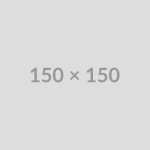

# Markdown Kitchen Sink
*A comprehensive guide to all supported elements across all themes.*

## Text Formatting
**Bold Text** and *Italic Text* or ***Bold Italic***.
~~Strikethrough~~ is also supported.
You can also use <u>Underline</u> via HTML tags.

## Headers
# H1 Header
## H2 Header
### H3 Header
#### H4 Header
##### H5 Header
###### H6 Header

## Alerts & Callouts (GitHub, Notion, Obsidian, GitBook)
> [!NOTE]
> Highlights useful information that users should take note of even when skimming.

> [!TIP]
> Helpful advice or best practices for doing things more effectively.

> [!IMPORTANT]
> Key information essential for users to achieve their goal.

> [!WARNING]
> Urgent info that requires immediate user attention to avoid problems.

> [!CAUTION]
> Advises about potential risks or negative consequences of an action.

## Knowledge & Connections (Obsidian Style)
Here are internal wiki-links: [[Architecture Overview]] and [[Configuration Guide|Custom Setup Options]].

Categorized tag badges: #documentation #release/v1.0 #guide #productivity

## Lists
### Unordered
- Item 1
- Item 2
  - Nested Item 2.1
  - Nested Item 2.2
    - Deeply Nested

### Ordered
1. First
2. Second
3. Third
   1. Sub-item
   2. Sub-item

### Task List
- [x] Completed task
- [ ] Pending task
- [ ] **Bold** task name

## Code
Inline `code` looks like this.

```javascript
// JavaScript Block with Language Header
function sayHello(name) {
  console.log(`Hello, ${name}! Welcome to NetMD.`);
}

sayHello("Developer");
```

```python
# Python Block with Language Header
def calculate_metrics(values):
    return {
        "count": len(values),
        "total": sum(values),
        "mean": sum(values) / len(values) if values else 0
    }
```

## Blockquotes
> This is a standard blockquote.
>
> > Nested blockquotes are also supported.

## Interactive Toggles (Notion Style)
<details>
<summary>Click to expand: What makes NetMD unique?</summary>
NetMD operates 100% locally inside your browser, guaranteeing total privacy while rendering Markdown to PDF. No data ever leaves your computer.
</details>

<details>
<summary>Click to expand: Supported Theme Styles</summary>
- **GitHub**: Clean, technical with language headers and native alerts.
- **Notion**: Modular page with tinted callouts, fluid toggles and clean tables.
- **Obsidian**: Connected knowledge with wiki-links, tag pills, and property tables.
- **Typora**: Distraction-free WYSIWYG reading experience with editorial typography.
- **GitBook / Docusaurus**: Technical manual layout with breadcrumbs and admonitions.
</details>

## Tables
| Feature | GitHub | Notion | Obsidian | Typora | GitBook |
| :--- | :---: | :---: | :---: | :---: | :---: |
| Code Language Headers | Yes | Yes | Yes | Yes | Yes |
| Callouts / Alerts | GFM Alerts | Tinted Blocks | Box Callouts | Quote Box | Admonition Bars |
| Wiki-links | Yes | Mention | Wiki Pill | Underline | Cross-ref |
| Tag Badges | Topic Badge | Property Pill | Mauve Pill | Minimal | Doc Badge |

## Links & Images
[Visit Example](https://example.com)



## HTML Elements
Keyboard shortcuts: <kbd>Ctrl</kbd> + <kbd>C</kbd> or <kbd>Cmd</kbd> + <kbd>P</kbd> to print.

## Emojis (Unicode)
🚀 💻 📝 ✨ 🎉 🔒 📊 💡

## Horizontal Rule
---
End of document.
